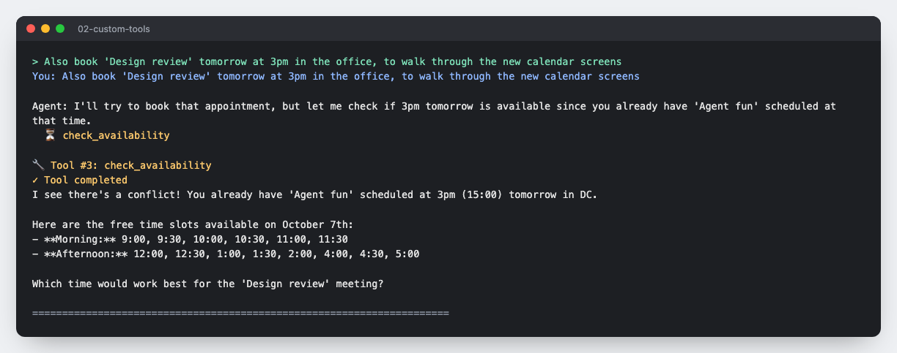
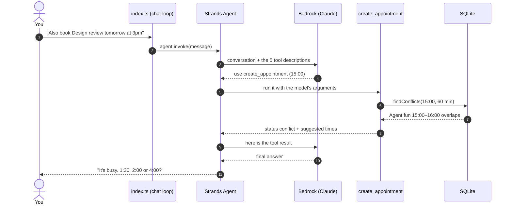
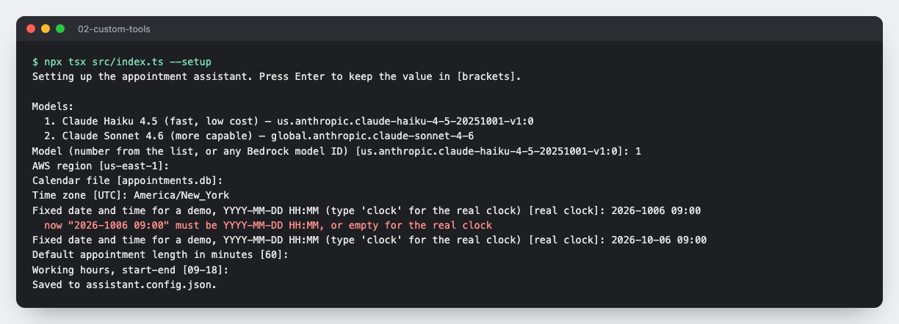
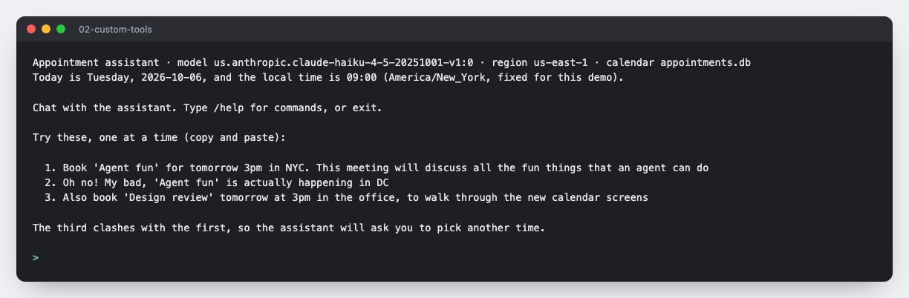
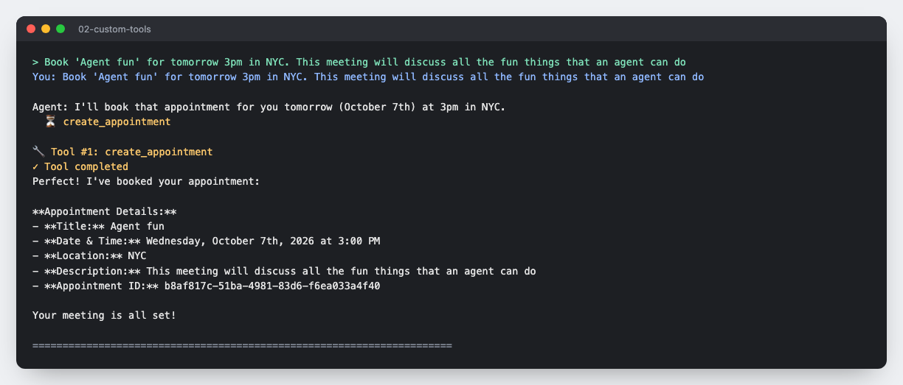
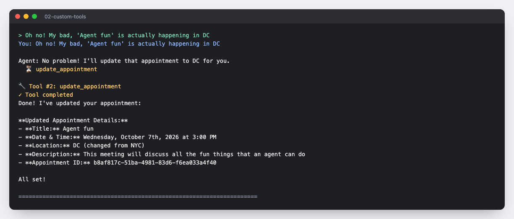
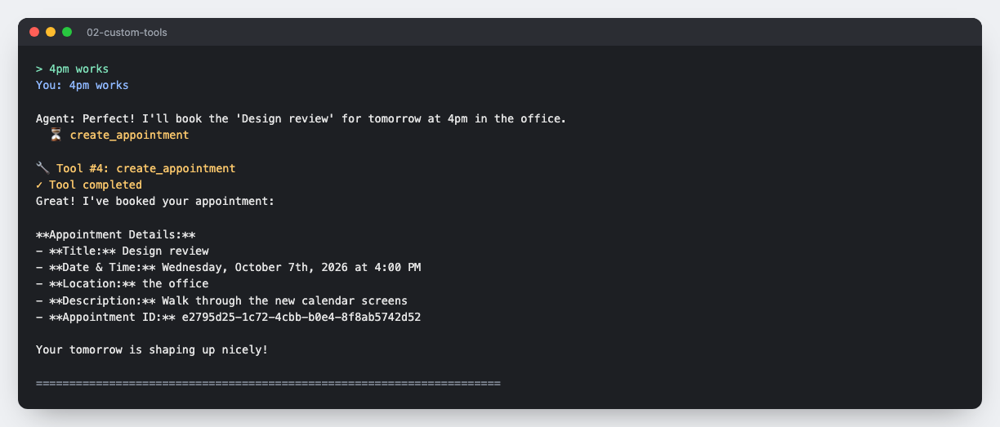
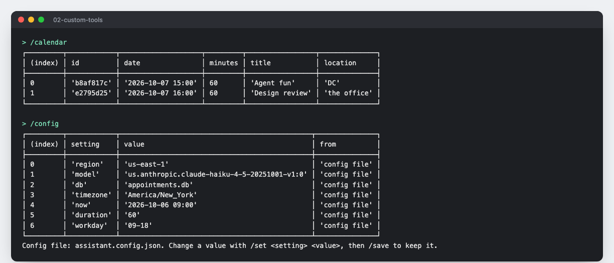

# Strands Calendar Agent

A turn-by-turn calendar assistant built with [Strands Agents](https://strandsagents.com/) (TypeScript) on Amazon Bedrock. It books, moves, checks and cancels appointments in plain English, stores them in SQLite, and **never double-books**: when a slot is busy, it tells you what's in the way, offers free times, and asks you what to do.

[](https://github.com/schinchli/strands-calendar-agent/actions/workflows/ci.yml)

It's a small, readable example of the patterns most tool-using agents need: custom tools with typed inputs, rules enforced in code rather than only in the prompt, a real conversation loop, and settings you can change without touching code.

**Read the walkthrough:** [How I built a Strands agent that never double-books](https://schinchli.github.io/blog/strands-calendar-agent/)



## Quick start

You need Node.js 22 or later, and AWS credentials that can call Amazon Bedrock with the model enabled in your region.

```bash
git clone https://github.com/schinchli/strands-calendar-agent.git
cd strands-calendar-agent
npm install
npm run dev        # guided demo: two requests, a clash, then it's your turn
```

Other ways to start:

```bash
npm run setup      # choose model, region, time zone and more; saved to assistant.config.json
npm run chat       # chat from the first turn
npm test           # 12 tests of the calendar rules and settings; no AWS needed
```

Try these in the chat, in order:

```
Book 'Agent fun' for tomorrow 3pm in NYC. This meeting will discuss all the fun things that an agent can do
Oh no! My bad, 'Agent fun' is actually happening in DC
Also book 'Design review' tomorrow at 3pm in the office, to walk through the new calendar screens
```

The third one clashes with the first, so the agent asks you to pick another time. Answer "4pm works", then type `/calendar` to see what was saved.

## How it works



Your code makes one call per turn, `agent.invoke()`. Strands runs the agent loop: it sends the conversation and tool descriptions to the model, runs the tool the model picks, sends the result back, and repeats until the model answers. It also keeps the conversation and streams the reply.

| File | Job |
|---|---|
| [`src/index.ts`](src/index.ts) | Terminal app: setup, guided demo, chat loop, `/commands`; builds the Strands `Agent` |
| [`src/config.ts`](src/config.ts) | Settings from flags, environment variables or a config file, with validation |
| [`src/tools/AppointmentTools.ts`](src/tools/AppointmentTools.ts) | The five tools, defined with Strands' `tool()` and Zod schemas |
| [`src/database/AppointmentDatabase.ts`](src/database/AppointmentDatabase.ts) | SQLite storage, overlap checks, free slots |
| [`test/calendar.test.ts`](test/calendar.test.ts) | Tests for the rules the tools rely on |

### The tools

| Tool | What it does |
|---|---|
| `create_appointment` | Books a meeting, unless it overlaps one. Then it saves nothing and returns the clash plus the three nearest free times. |
| `list_appointments` | Lists everything booked |
| `update_appointment` | Changes a meeting, with the same overlap check when the time moves |
| `check_availability` | Lists the free start times on a day, within working hours |
| `delete_appointment` | Deletes when called with `confirmed: true`. With `confirmed: false` it deletes nothing and asks for confirmation. |

### The key idea: a tool can return a decision

Asking a model to "never double-book" works most of the time. Making the tool refuse works every time. On a clash, `create_appointment` returns this instead of saving:

```json
{
  "status": "conflict",
  "message": "The calendar is busy at that time. Nothing was saved. Offer the user the suggested_start_times and ask how to proceed.",
  "conflicts": [{ "title": "Agent fun", "date": "2026-10-07 15:00", "duration_minutes": 60 }],
  "suggested_start_times": ["13:30", "14:00", "16:00"]
}
```

The model reads the result and asks you what to do. Returning three ready-made times, rather than a long list, also stops the model inventing times that aren't really free.

**What's enforced, and what isn't:** no double-booking is enforced by code. Asking before cancelling relies on the model: it sets `confirmed` itself. For a hard guarantee, have your app ask the user directly, for example with Strands' human-in-the-loop interventions.

## Use it in your own project

The pattern carries over to any agent that acts on real data:

1. **Define each action as a tool** with `tool({ name, description, inputSchema, callback })`. The description is how the model decides when to use it, so say what it does and what it refuses.
2. **Put the rules that must hold into the callback**, and return a structured result (`status`, a plain-language `message`, and the options) when the action can't go ahead.
3. **Give the agent context it can't guess** in the system prompt: today's date and time zone, defaults, and how to behave when a tool says no.
4. **Keep one `Agent` per conversation** and call `agent.invoke()` per turn; Strands keeps the history.

To swap SQLite for a real calendar (Google Calendar, Outlook, your own API), replace the methods in `AppointmentDatabase.ts` and keep the tools as they are.

## Settings

| Setting | Flag | Environment variable | Default |
|---|---|---|---|
| Bedrock region | `--region` | `AWS_REGION` | `us-east-1` |
| Model ID or inference profile | `--model` | `MODEL_ID` | `us.anthropic.claude-haiku-4-5-20251001-v1:0` |
| Calendar file | `--db` | `APPOINTMENTS_DB` | `appointments.db` |
| Time zone | `--timezone` | `ASSISTANT_TIMEZONE` | your system time zone |
| Fixed "now" for demos, `YYYY-MM-DD HH:MM` | `--now` | `ASSISTANT_NOW` | the real clock |
| Default meeting length, minutes | `--duration` | `ASSISTANT_DURATION` | `60` |
| Minutes kept free after each meeting (0 = back-to-back) | `--buffer` | `ASSISTANT_BUFFER` | `0` |
| Working hours | `--workday` | `ASSISTANT_WORKDAY` | `09-18` |

Priority: flag, then environment variable, then `assistant.config.json` (git-ignored), then default. In the chat, `/config` shows each value and its source, `/set <setting> <value>` changes one without losing the conversation, and `/save` stores it. Run `npm run dev -- --help` for everything.

## Walkthrough

| | |
|---|---|
|  | **Setup** asks for each setting and rejects invalid values. |
|  | **Ready**: the header shows your settings, and the sample requests are printed. |
|  | **Book** with `create_appointment`. |
|  | **Move** with `update_appointment`. |
|  | **Clash**: nothing is saved, free times are offered, you're asked. |
|  | **Your answer** is booked. |
|  | `/calendar` and `/config`. |

## Credits and license

Derived from the `02-custom-tools` TypeScript sample in [strands-agents/samples](https://github.com/strands-agents/samples), and licensed under the [Apache License 2.0](LICENSE), like the original. See [NOTICE](NOTICE) for attribution and a summary of changes. This is a personal project, not an official AWS or Strands Agents project.
